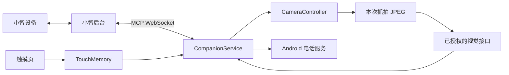

# 开发指南

返回 [README](../README.md) · [使用指南](user-guide.md) · [发布指南](publishing.md)

## 构建环境

| 项目 | 当前值 |
| --- | --- |
| 应用名 / Gradle 项目名 | 伴侣 / Companion |
| applicationId / namespace | `cn.bigfish.phone` |
| 版本 | `0.1.4`，versionCode `5`，以 `app/build.gradle` 为准 |
| Android | minSdk 26，compileSdk / targetSdk 35 |
| 语言 / JDK | Java 11 语言级别，使用 JDK 17 或 21 构建 |
| Gradle / AGP | 8.11.1 / 8.9.1 |
| Build Tools | 已验证 35.0.0 |

SDK 通过 `ANDROID_HOME` 或本机 `local.properties` 配置。后者包含机器相关路径，应留在本机。首次构建需要联网下载 Gradle 和 Maven 依赖。

Wrapper 的网络超时设为 60 秒，并校验 Gradle 发行包 SHA-256。若首次下载超时，先确认本机能访问 Gradle 发行地址及其重定向目标；使用本机网络配置解决下载问题，保留校验值。本次本地验证使用了与该校验值一致的缓存发行包，不代表首次联网下载已验证成功。

Windows 使用 `gradlew.bat`；Linux / macOS 可使用 `bash ./gradlew`，或赋予脚本执行权限后运行 `./gradlew`。

```powershell
.\gradlew.bat testReleaseUnitTest lintRelease assembleDebug
.\gradlew.bat assembleRelease
```

调试包位于 `app/build/outputs/apk/debug/app-debug.apk`；未签名发布包位于 `app/build/outputs/apk/release/app-release-unsigned.apk`。

## 代码职责

实现保留在标准 Android 源码树内，按职责拆为独立类；本次仓库整理未修改运行逻辑和包名。

| 类 | 职责 |
| --- | --- |
| `MainActivity`、`ViewportScrollView` | 四个 Tab、权限入口、配置表单与滚动位置 |
| `PetTouchView` | 原始图集的帧动画、手势接收与震动反馈 |
| `CompanionService` | 前台服务、MCP WebSocket、重连、工具调度与通知 |
| `CameraController`、`CameraPolicy` | Camera2 生命周期、前后镜头、抓拍、对焦与 JPEG 方向 |
| `Protocol` | JSON-RPC / MCP 响应、工具 schema、号码与 URL 校验 |
| `VisionClient`、`VisionChallenge` | 官方 / 自定义视觉请求与随机图验证 |
| `Settings`、`SecretStore`、`WebConfig` | 配置校验、Keystore 加密存储、网页配置合并与脱敏 |
| `PhoneWebServer` | 可选的局域网 HTTP 配置服务，默认端口 8769 |
| `DirectDial` | 电话请求校验、调用系统网关与短时间重复呼叫抑制 |
| `TouchGesture`、`TouchMemory` | 手势分类、事件编号、限量历史与五分钟过期 |

主流程：



界面负责预览挂接，相机本体归服务管理。离开“看世界”页时切换到内部输出缓冲，不因 Tab 切换关闭相机。切镜头时检查可用镜头，停止旧会话并重开；抓拍必须使用本次请求的图像时间戳，不复用旧照片。

## 配置与兼容

- `Settings` 定义 MCP 接入点、自定义视觉 URL / 模型 / Key、Device-Id、联系人及图片模式；`SecretStore` 加密保存。
- 前后镜头选择单独保存在应用私有 SharedPreferences；它不是 API 密钥。
- MCP 支持旧式初始化与单次调用元数据中的视觉能力；官方通道使用 `question + file` multipart，自定义通道使用带图片的 Chat Completions 请求。
- 保留 applicationId、Keystore 别名与存储名称，才能继续覆盖旧版本并解密已有配置。
- 发布签名不在仓库中。自行构建的调试签名不能覆盖原发布签名，卸载会丢失私有配置。

## 验证

运行 `testReleaseUnitTest lintRelease`。测试报告位于 `app/build/reports/tests/testReleaseUnitTest/`，Lint 报告位于 `app/build/reports/lint-results-release.html`。现有 36 项测试覆盖协议、HTTP 模拟视觉、拨号网关、触摸事件和相机选择策略；不使用真实手机号、相机或付费接口。

`androidx.annotation:annotation:1.8.1` 保持与当前运行依赖对齐，因此 Lint 有一项新版本提示。升级依赖时需重新核对兼容性。

`python scripts/check_repository.py` 检查文档相对链接、所需文件、图集哈希及待分发文件中的常见密钥特征。它不替代 Android 测试、实机验证或完整安全审计。

GitHub Actions 使用同一 Gradle Wrapper，运行 JVM 测试、Lint、调试构建和仓库检查，不使用发布密钥，也不自动创建 Release。

## 后续实机验证

记录手机型号、系统 / MIUI 版本和 APK 版本，重点检查前后镜头四方向照片、切换 Tab 后抓拍、锁屏保活、通知关闭、电话权限与双卡行为。提交问题时不要附带真实 MCP 接入点、API Key、联系人或带访问口令的配置链接。
